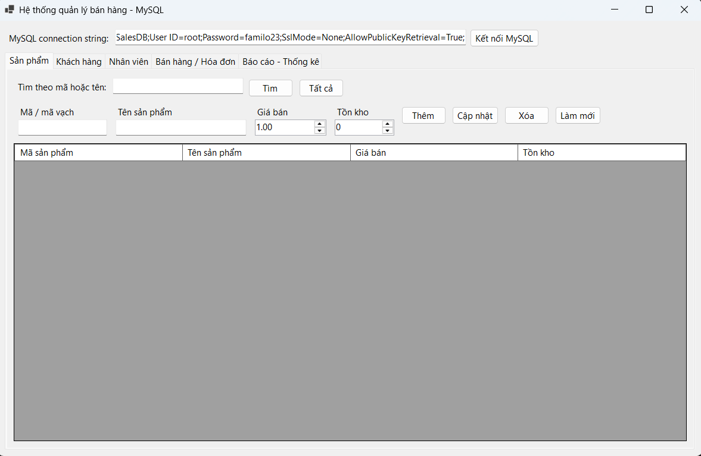
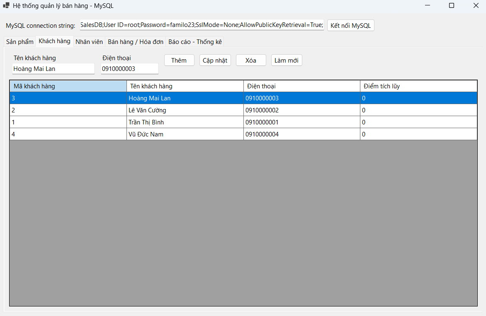
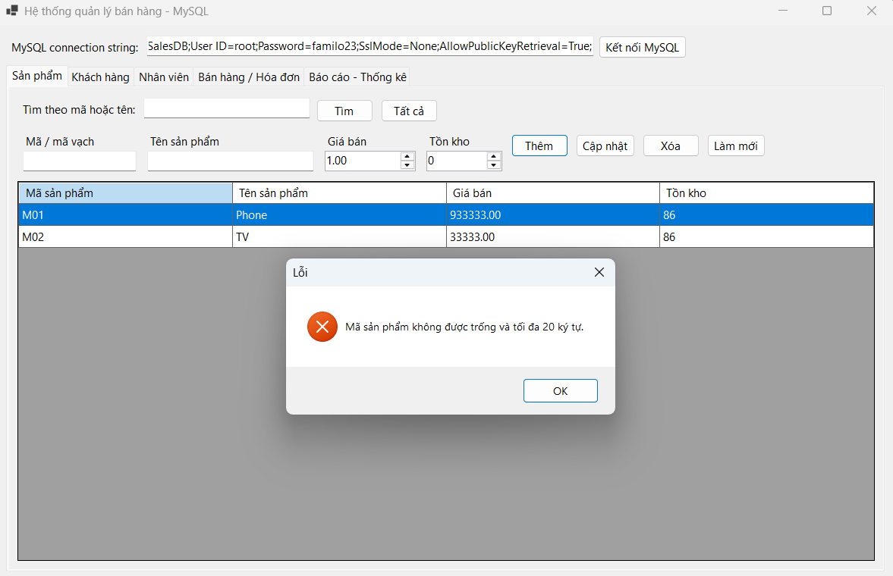
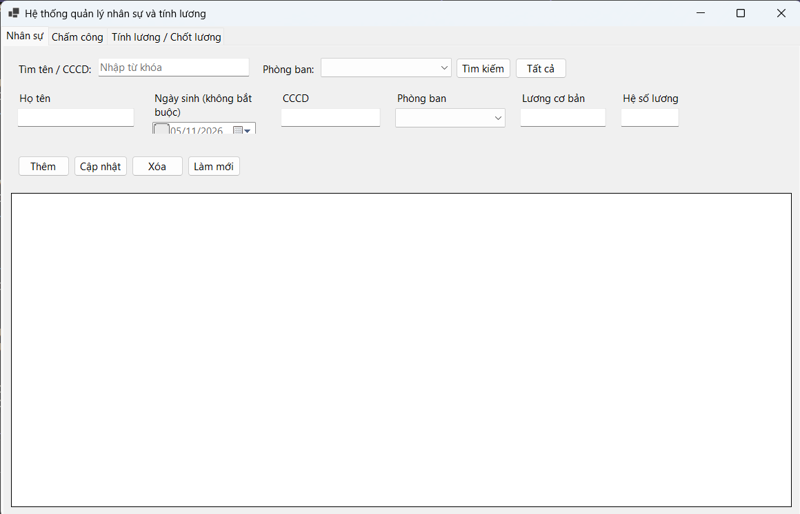
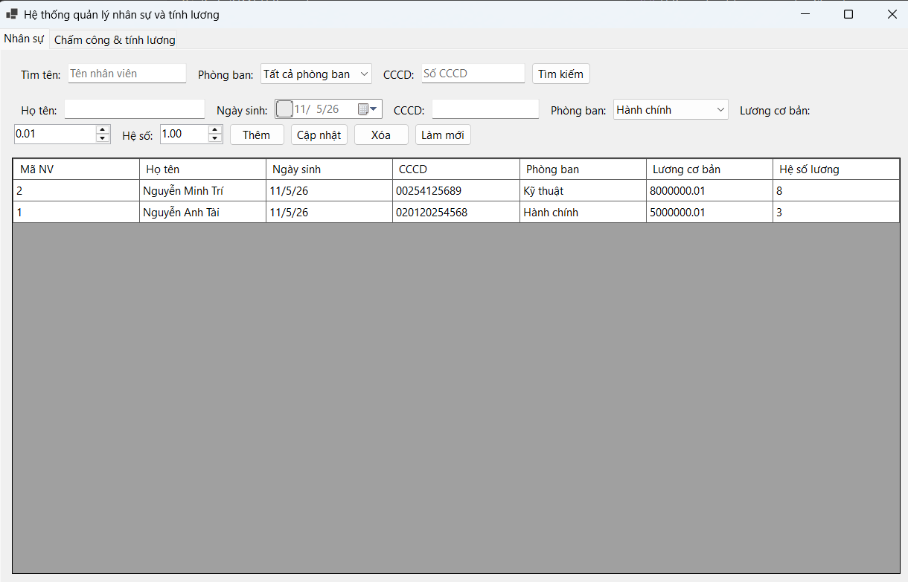
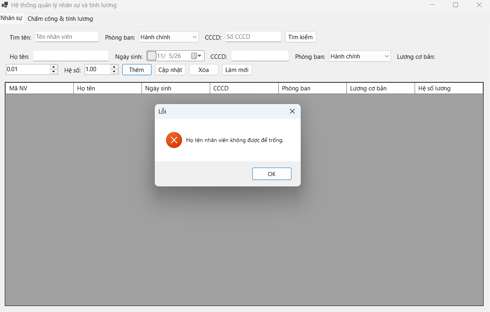

## THÔNG TIN SINH VIÊN
- **Họ và tên:** Nguyễn Anh Xuân
- **Mã số sinh viên:** 24810320189
- **Lớp:** D19QTANM1
- **Học phần:** Lập trình .NET / Lập trình Windows Forms
- **Tên bài tập:** Bài tập thực hành ngày 05/11 – Bài 6.1, Bài 6.2

---

### PHẦN 1. BÀI 6.1 – HỆ THỐNG QUẢN LÝ BÁN LẺ & SIÊU THỊ (RETAIL SALES POS)
#### Hình ảnh minh chứng kết quả thực hành

##### 6.1.1 Giao diện chính Quản lý bán lẻ siêu thị
Màn hình làm việc chính tích hợp cấu hình kết nối CSDL MySQL `SalesDB`, danh mục sản phẩm và giỏ hàng.

##### 6.1.2 Nạp danh mục sản phẩm và thông tin khách hàng
Đồng bộ danh sách mặt hàng và nạp dữ liệu khách hàng thân thiết lên các điều khiển giao diện.

##### 6.1.3 Thêm sản phẩm vào giỏ hàng và tính thành tiền
Thêm các sản phẩm vào lưới chi tiết hóa đơn, tự động tính tổng tiền thanh toán theo số lượng và đơn giá.
.png)

##### 6.1.4 Cập nhật điểm tích lũy thành công cho khách hàng
Hệ thống tự động cộng dồn điểm tích lũy cho khách hàng sau khi hoàn tất thanh toán hóa đơn.
.png)

##### 6.1.5 Tự động trừ số lượng hàng tồn kho sau bán
Cập nhật giảm số lượng tồn kho của các mặt hàng đã bán một cách đồng bộ và an toàn bằng Transaction.
.png)

##### 6.1.6 Danh sách lịch sử hóa đơn bán hàng
Bảng DataGridView lưu trữ toàn bộ các hóa đơn đã lập kèm thông tin ngày lập, nhân viên và khách hàng.
.png)

##### 6.1.7 Kiểm tra xác thực số lượng hàng tồn kho (Validation Error)
Cảnh báo lỗi khi số lượng sản phẩm khách đặt vượt quá lượng tồn kho thực tế trong CSDL.

##### 6.1.8 Kiểm tra xác thực thông tin bắt buộc khi lập hóa đơn
Thông báo yêu cầu chọn khách hàng hoặc bổ sung đầy đủ thông tin trước khi thực hiện thanh toán.
.png)

---

### PHẦN 2. BÀI 6.2 – HỆ THỐNG QUẢN LÝ NHÂN SỰ & TIỀN LƯƠNG (HRM & PAYROLL MANAGEMENT)
#### Hình ảnh minh chứng kết quả thực hành

##### 6.2.1 Giao diện chính Quản lý nhân sự và tiền lương
Giao diện phân vùng trực quan giữa danh sách nhân viên, thông tin chi tiết và chức năng chấm công.

##### 6.2.2 Danh sách nhân viên phân cấp theo phòng ban
Hiển thị danh sách nhân sự đầy đủ mã nhân viên, họ tên, chức vụ, mức lương cơ bản và hệ số lương.

##### 6.2.3 Thêm mới hồ sơ nhân sự vào hệ thống
Thêm thành công nhân viên mới vào phòng ban chỉ định và lưu dữ liệu vào CSDL `HRMDB`.
.png)

##### 6.2.4 Ghi nhận dữ liệu chấm công và giờ làm thêm OT
Ghi nhận số ngày công chuẩn trong tháng và số giờ làm thêm ngoài giờ cho từng nhân viên.
.png)

##### 6.2.5 Bảng lương tự động tính toán thực lĩnh
Hệ thống tự động kích hoạt công thức và Trigger CSDL để tính toán chính xác số tiền thực lĩnh của nhân viên.
.png)

##### 6.2.6 Thống kê tổng hợp quỹ lương của doanh nghiệp
Báo cáo tổng kết quỹ tiền lương chi trả cho toàn bộ nhân sự theo từng tháng làm việc.
.png)

##### 6.2.7 Kiểm tra xác thực dữ liệu chấm công (Validation Error)
Cảnh báo khi số ngày công nhập vào không hợp lệ hoặc vượt quá số ngày tối đa trong tháng.

