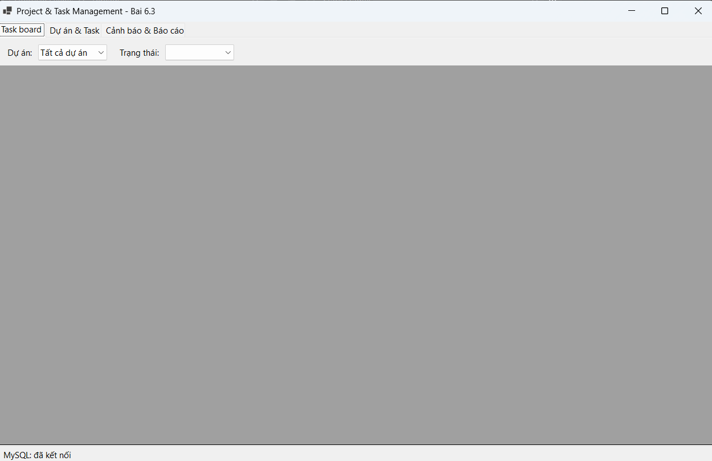
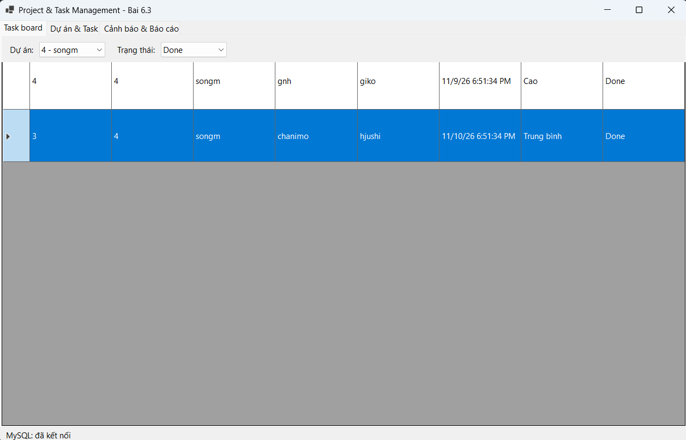
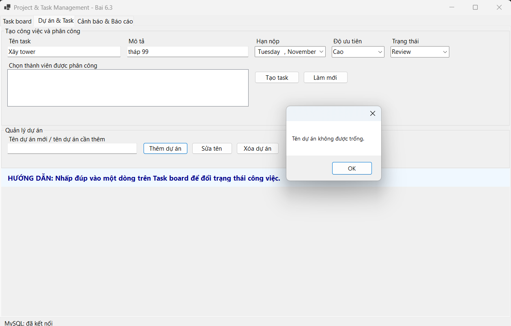
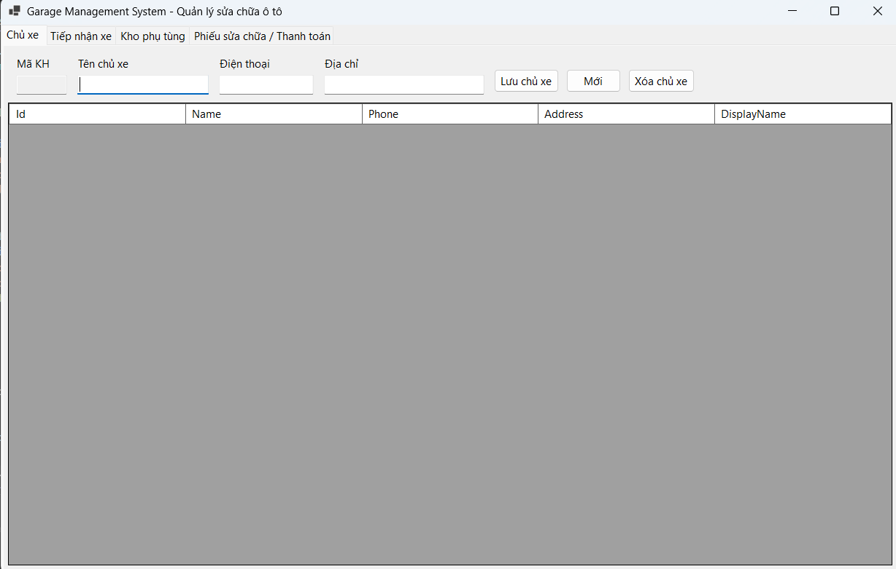
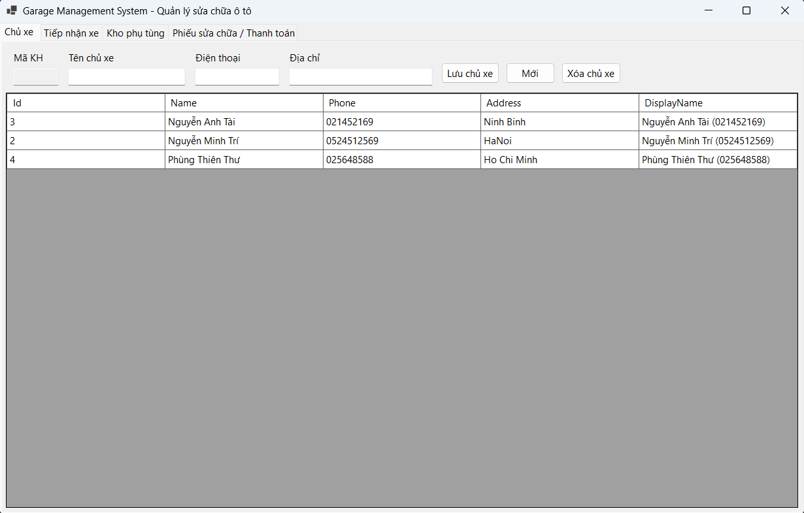
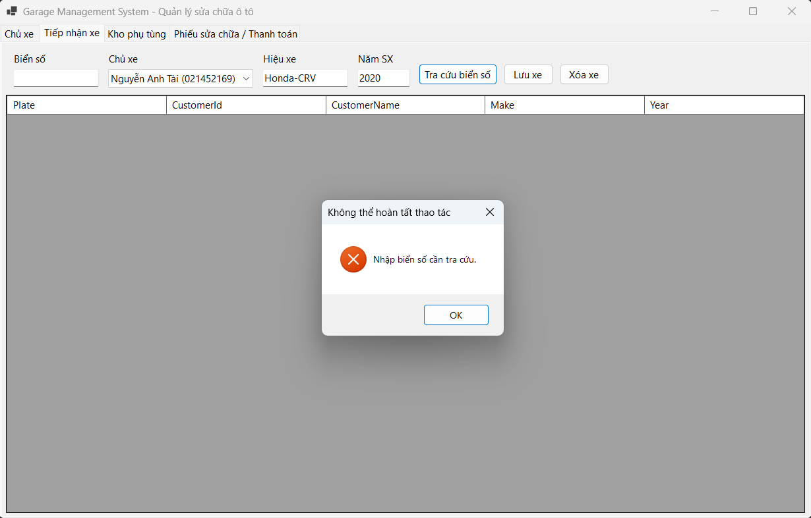
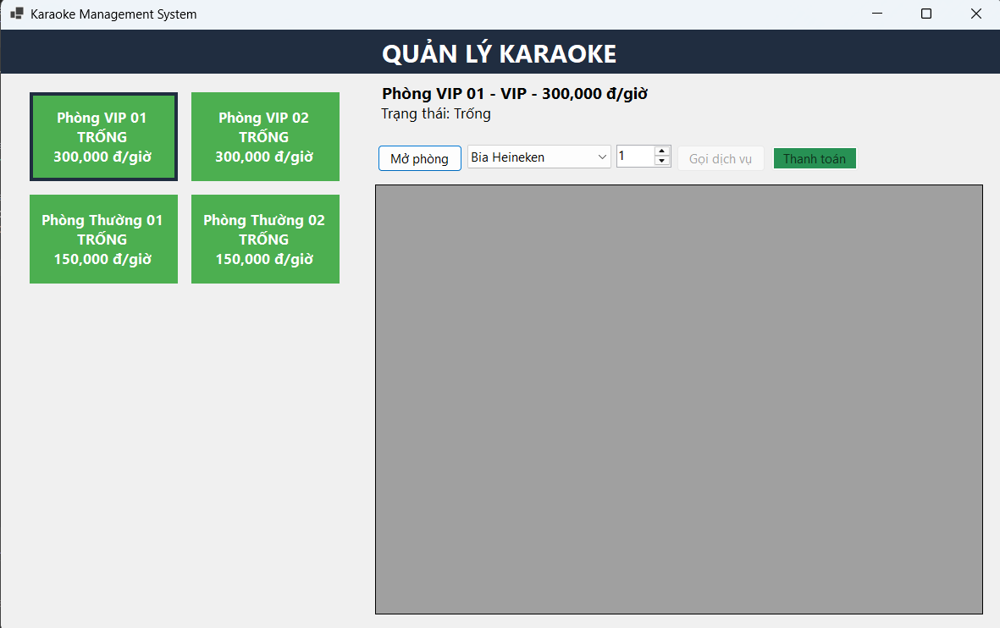
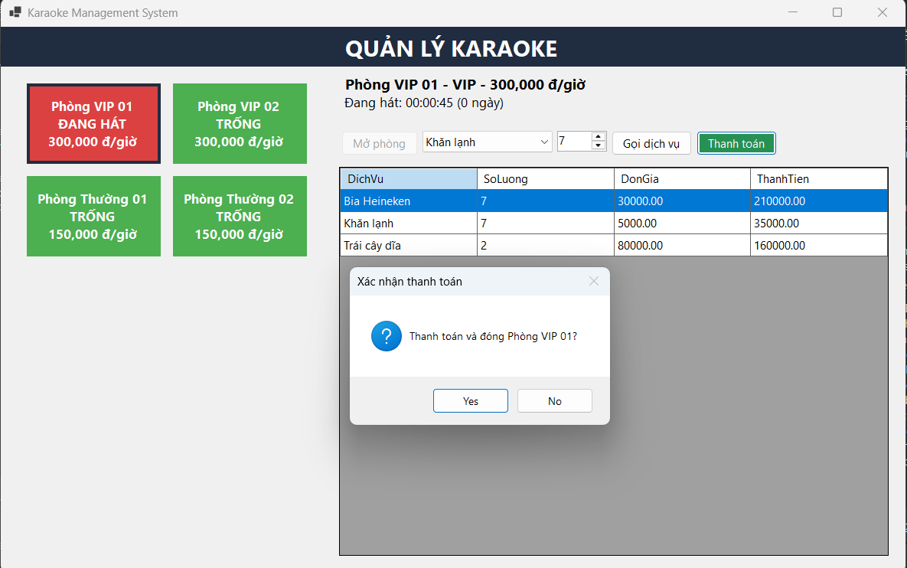

## THÔNG TIN SINH VIÊN
- **Họ và tên:** Nguyễn Anh Xuân
- **Mã số sinh viên:** 24810320189
- **Lớp:** D19QTANM1
- **Học phần:** Lập trình .NET / Lập trình Windows Forms
- **Tên bài tập:** Bài tập thực hành ngày 10/11 – Bài 6.3, Bài 6.4, Bài 6.5

---

### PHẦN 1. BÀI 6.3 – HỆ THỐNG QUẢN LÝ DỰ ÁN VÀ CÔNG VIỆC (PROJECT & TASK MANAGER)
#### Hình ảnh minh chứng kết quả thực hành

##### 6.3.1 Giao diện chính Quản lý dự án
Màn hình trung tâm hiển thị danh sách các dự án đang triển khai, thông tin mô tả và thời hạn thực hiện.

##### 6.3.2 Giao diện phân công và theo dõi tiến độ công việc
Bảng theo dõi các đầu việc chi tiết của từng dự án, phân công nhân sự phụ trách và mức độ ưu tiên.
.png)

##### 6.3.3 Thống kê chi tiết và báo cáo công việc theo dự án
Hiển thị tổng hợp tỷ lệ hoàn thành, số lượng công việc đã xong, đang thực hiện hoặc quá hạn.
.png)

##### 6.3.4 Tạo mới dự án và thiết lập kế hoạch thực hiện
Thực hiện thêm dự án mới thành công vào CSDL `ProjectTaskDB` và cập nhật danh sách hiển thị.

##### 6.3.5 Phân công nhiệm vụ cho thành viên thực hiện
Giao việc chi tiết cho từng nhân viên kèm theo thời hạn hoàn thành cụ thể.
.png)

##### 6.3.6 Cập nhật trạng thái hoàn thành và tiến độ công việc
Ghi nhận tiến độ công việc và chuyển trạng thái công việc sang hoàn thành.
.png)

##### 6.3.7 Kiểm tra xác thực dữ liệu đầu vào (Validation Error)
Hệ thống hiển thị thông báo lỗi khi để trống tên dự án hoặc thiết lập ngày kết thúc trước ngày bắt đầu.

---

### PHẦN 2. BÀI 6.4 – HỆ THỐNG QUẢN LÝ GARAGE SỬA CHỮA XE (GARAGE SERVICE TRACKER)
#### Hình ảnh minh chứng kết quả thực hành

##### 6.4.1 Giao diện chính Tiếp nhận xe sửa chữa
Màn hình tiếp nhận phương tiện vào xưởng, ghi nhận biển số, số điện thoại và thông tin chủ xe.

##### 6.4.2 Giao diện Quản lý danh sách khách hàng và phương tiện
Quản lý thông tin hồ sơ phương tiện, lịch sử các lần bảo dưỡng và sửa chữa tại garage.
.png)

##### 6.4.3 Danh mục phụ tùng thay thế và linh kiện garage
Bảng DataGridView hiển thị danh mục các loại linh kiện, phụ tùng, đơn giá và số lượng tồn trong kho.
.png)

##### 6.4.4 Tổng hợp hóa đơn sửa chữa và phiếu thanh toán
Khu vực tổng hợp chi phí tiền công sửa chữa và tiền linh kiện thay thế cho từng phiếu dịch vụ.
.png)

##### 6.4.5 Tiếp nhận thông tin phương tiện và chủ xe vào garage
Ghi nhận thành công xe vào xưởng và lưu thông tin vào CSDL MySQL `GarageDB`.

##### 6.4.6 Lập phiếu tiếp nhận sửa chữa phương tiện
Khởi tạo phiếu sửa chữa mới, chẩn đoán các hạng mục hỏng hóc cần xử lý.
.png)

##### 6.4.7 Chỉ định phụ tùng thay thế và tính toán chi phí linh kiện
Thêm các phụ tùng cần thay thế vào phiếu, tự động tính tổng tiền linh kiện theo số lượng và đơn giá.
.png)

##### 6.4.8 Cập nhật trạng thái sửa chữa và tiến độ kỹ thuật viên
Cập nhật quy trình bảo dưỡng từ tiếp nhận, đang sửa chữa đến đã hoàn thành nghiệm thu.
.png)

##### 6.4.9 Nghiệm thu và xuất hóa đơn thanh toán cho khách hàng
Hoàn tất phiếu sửa chữa, xuất hóa đơn tổng hợp tiền công và phụ tùng cho khách hàng.
.png)

##### 6.4.10 Kiểm tra xác thực thông tin biển số và chủ xe (Validation Error)
Cảnh báo hộp thoại khi người dùng để trống biển số xe hoặc thông tin liên hệ khách hàng.

##### 6.4.11 Kiểm tra xác thực chi phí và số lượng phụ tùng
Bắt lỗi khi nhập số lượng phụ tùng không hợp lệ hoặc lớn hơn số lượng tồn trong kho.
.png)

---

### PHẦN 3. BÀI 6.5 – HỆ THỐNG QUẢN LÝ QUÁN KARAOKE & DỊCH VỤ (KARAOKE CLUB MANAGEMENT)
#### Hình ảnh minh chứng kết quả thực hành

##### 6.5.1 Giao diện chính Sơ đồ phòng hát Karaoke trực quan
Sơ đồ phòng hát phân biệt trạng thái bằng màu sắc trực quan (màu xanh: phòng Trống, màu đỏ: phòng Đang hát).

##### 6.5.2 Mở phòng hát cho khách và tự động tính cước giờ
Hệ thống tự động ghi nhận thời gian bắt đầu, chuyển trạng thái phòng và đếm giờ sử dụng.

##### 6.5.3 Gọi món đồ uống, đồ ăn nhẹ vào hóa đơn phòng
Lựa chọn các dịch vụ đi kèm kèm số lượng và đồng bộ vào chi tiết hóa đơn của phòng đang hát.
.png)

##### 6.5.4 Thanh toán tổng hợp cước giờ và dịch vụ, giải phóng phòng hát
Tính tiền phòng chính xác theo số phút thực tế, cộng dồn tiền dịch vụ, in hóa đơn và hoàn trả phòng về trạng thái Trống.
.png)
