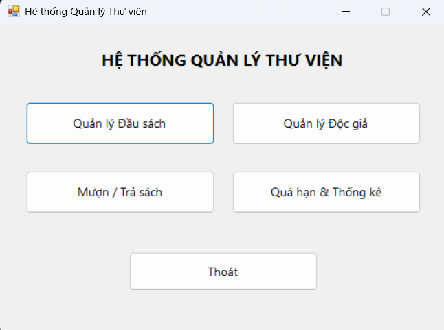
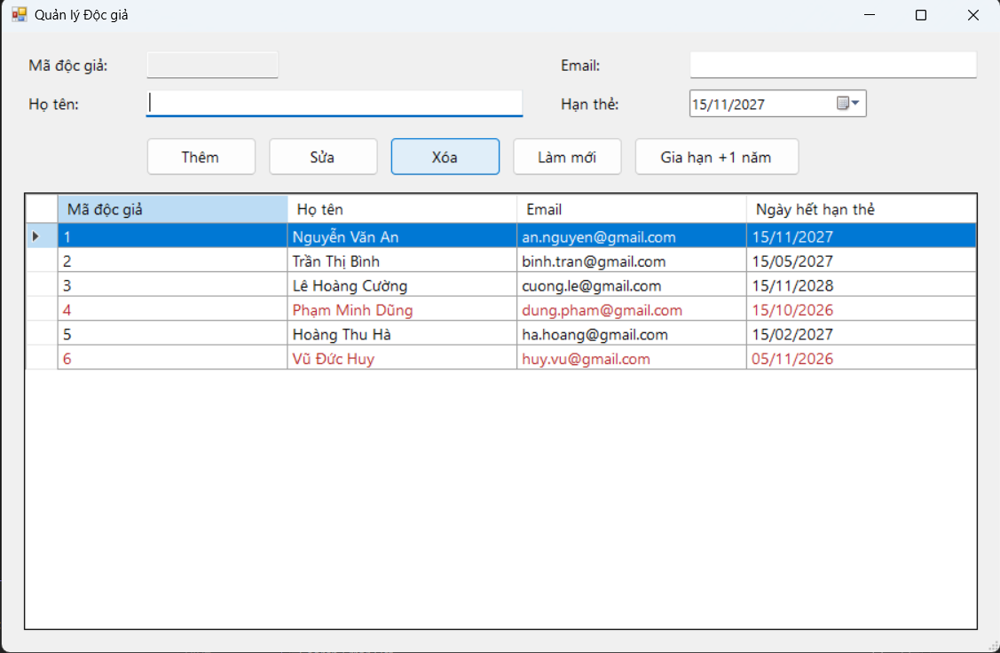
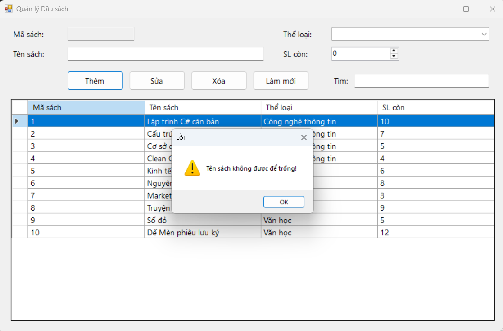
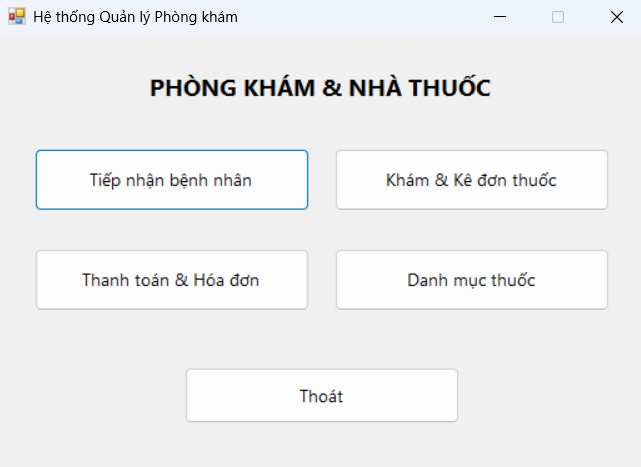
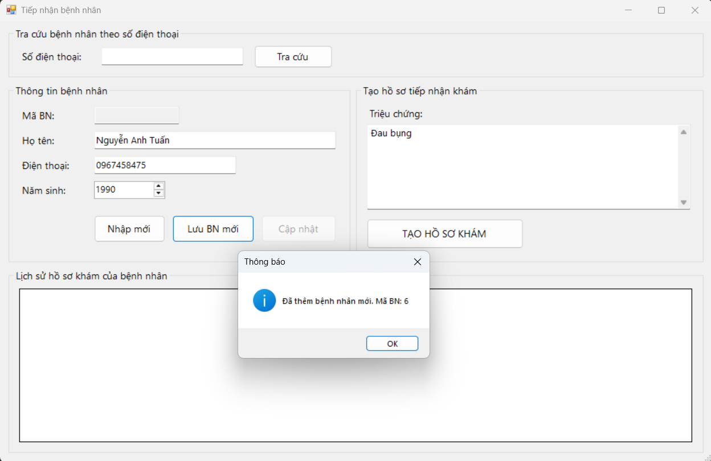
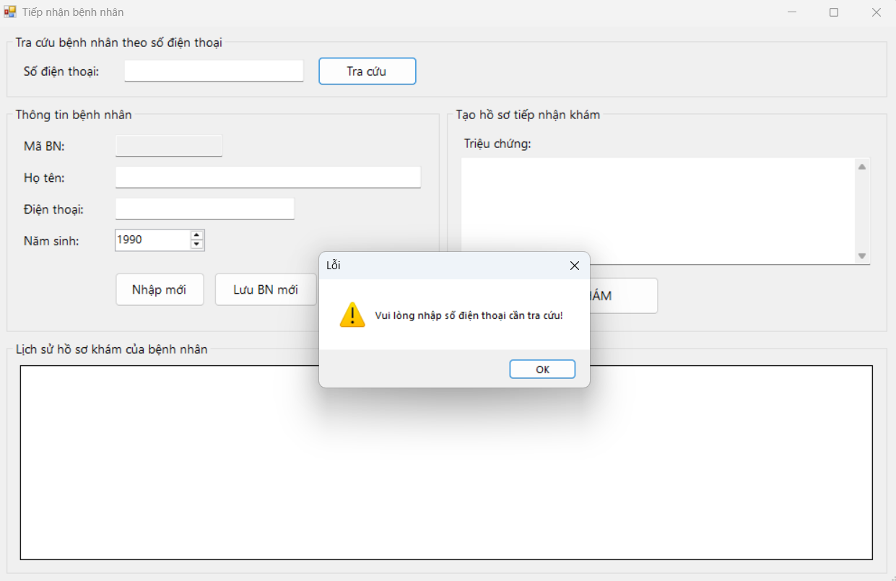
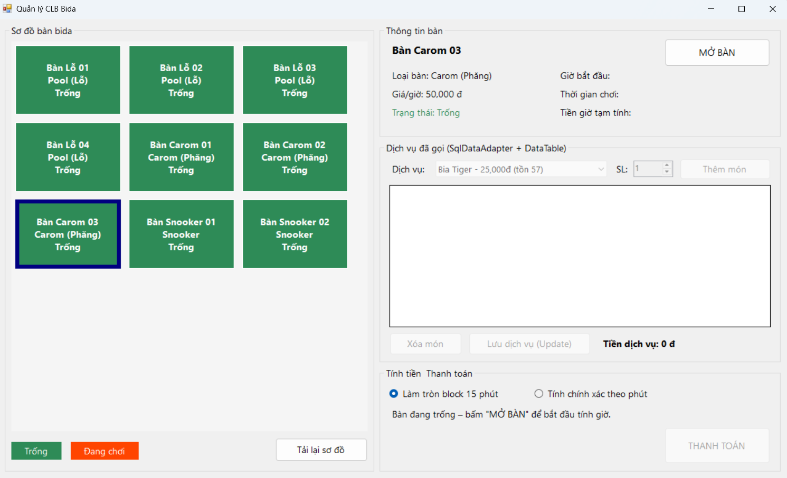
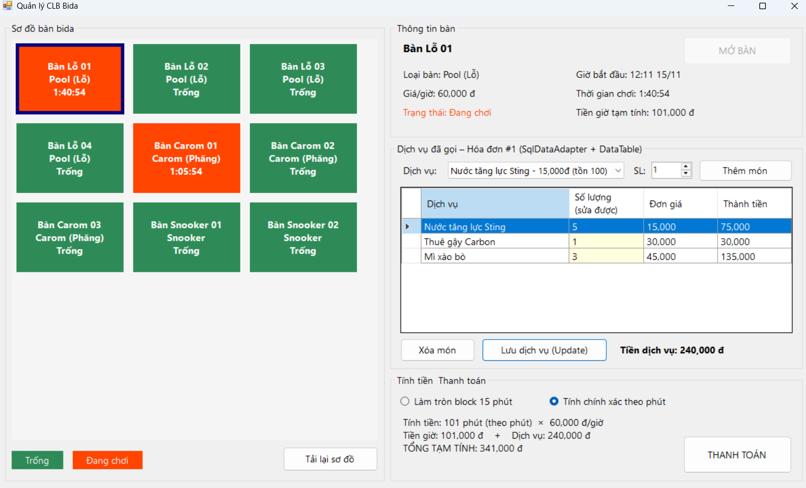

## THÔNG TIN SINH VIÊN
- **Họ và tên:** Nguyễn Anh Xuân
- **Mã số sinh viên:** 24810320189
- **Lớp:** D19QTANM1
- **Học phần:** Lập trình .NET / Lập trình Windows Forms
- **Tên bài tập:** Bài tập thực hành ngày 15/11 – Bài 6.6, Bài 6.7, Bài 6.8

---

### PHẦN 1. BÀI 6.6 – HỆ THỐNG QUẢN LÝ MƯỢN TRẢ SÁCH THƯ VIỆN (LIBRARY MANAGEMENT)
#### Hình ảnh minh chứng kết quả thực hành

##### 6.6.1 Giao diện chính Hệ thống Quản lý Thư viện
Màn hình trung tâm với hệ thống menu điều hướng mở các phân hệ Độc giả, Đầu sách, Mượn trả và Thống kê.

##### 6.6.2 Quản lý danh mục độc giả thư viện
Hiển thị danh sách thẻ độc giả trên DataGridView với đầy đủ thông tin cá nhân và ngày cấp thẻ.
.png)

##### 6.6.3 Quản lý danh mục đầu sách và tìm kiếm
Tra cứu danh mục sách theo thể loại, tên tác giả và kiểm tra số lượng sách hiện có trong kho.

##### 6.6.4 Lập phiếu mượn sách mới cho độc giả
Lập phiếu mượn sách thành công, ghi nhận ngày mượn, hạn trả và tự động cập nhật số lượng tồn kho.
.png)

##### 6.6.5 Tiếp nhận trả sách và tự động tính tiền phạt trễ hạn
Hệ thống tự động tính phí phạt dựa trên số ngày mượn quá hạn quy định khi tiếp nhận trả sách.
.png)

##### 6.6.6 Báo cáo thống kê số lượng sách theo thể loại
Bảng tổng hợp số lượng và tỷ lệ các đầu sách theo từng danh mục thể loại thư viện.
.png)

##### 6.6.7 Kiểm tra xác thực giới hạn mượn sách (Validation Error)
Cảnh báo khi độc giả vượt quá giới hạn mượn tối đa 3 cuốn sách hoặc sách đã hết trong kho.

---

### PHẦN 2. BÀI 6.7 – HỆ THỐNG QUẢN LÝ PHÒNG KHÁM & KÊ ĐƠN THUỐC (CLINIC MANAGEMENT)
#### Hình ảnh minh chứng kết quả thực hành

##### 6.7.1 Giao diện chính Hệ thống Quản lý Phòng khám
Giao diện phân hệ tiếp đón bệnh nhân và tổng quan các buồng khám bệnh.

##### 6.7.2 Tiếp nhận thông tin bệnh nhân đến khám
Ghi nhận hồ sơ bệnh nhân mới vào hệ thống kèm thông tin cá nhân và triệu chứng ban đầu.

##### 6.7.3 Tạo hồ sơ khám bệnh và chẩn đoán bệnh lý
Bác sĩ ghi nhận kết quả chẩn đoán bệnh và khởi tạo hồ sơ khám bệnh cho bệnh nhân.
.png)

##### 6.7.4 Lập đơn thuốc và chỉ định liều dùng
Kê đơn thuốc điều trị, chọn thuốc từ danh mục và chỉ định số lượng, hướng dẫn sử dụng.
.png)

##### 6.7.5 Danh mục kho dược và kiểm tra số lượng tồn
Bảng DataGridView hiển thị danh mục các loại thuốc, đơn vị tính và số lượng tồn kho.
.png)

##### 6.7.6 Chi tiết đơn thuốc đã kê cho bệnh nhân
Hiển thị danh sách các loại thuốc đã được bác sĩ kê trong đơn khám bệnh hiện tại.
.png)

##### 6.7.7 Tổng hợp chi phí khám và tiền thuốc
Tính toán tổng viện phí gồm tiền công khám và tổng tiền thuốc theo đơn đã kê.
.png)

##### 6.7.8 Hoàn tất thanh toán viện phí và in phiếu thu
Hệ thống xác nhận thanh toán thành công, xuất phiếu thu viện phí và hoàn tất quy trình khám.
.png)

##### 6.7.9 Kiểm tra lỗi thiếu thuốc trong kho dược (ThieuThuocException)
Hệ thống ném ngoại lệ nghiệp vụ và cảnh báo khi số lượng thuốc trong đơn vượt quá lượng tồn kho.

##### 6.7.10 Kiểm tra xác thực thông tin bắt buộc (Validation Error)
Cảnh báo khi thiếu thông tin bệnh nhân hoặc chưa nhập kết quả chẩn đoán bệnh lý.
.png)

---

### PHẦN 3. BÀI 6.8 – HỆ THỐNG QUẢN LÝ BÀN BIDA & DỊCH VỤ GIẢI TRÍ (BILLIARDS CLUB MANAGEMENT)
#### Hình ảnh minh chứng kết quả thực hành

##### 6.8.1 Giao diện chính Sơ đồ bàn Bida trực quan
Màn hình chính hiển thị sơ đồ bàn bida với màu sắc cập nhật trạng thái thời gian thực.

##### 6.8.2 Mở bàn cho khách và bắt đầu tính giờ chơi
Tiếp nhận khách vào bàn, hệ thống tự động ghi nhận giờ vào và chuyển màu bàn sang trạng thái đang chơi.
.png)

##### 6.8.3 Gọi món dịch vụ đồ uống vào hóa đơn của bàn
Lựa chọn các mặt hàng đồ uống, thức ăn kèm số lượng và nạp vào hóa đơn của bàn đang hoạt động.

##### 6.8.4 Bảng chi tiết các dịch vụ bàn đang sử dụng
Hiển thị bảng chi tiết các dịch vụ phát sinh kèm số lượng, đơn giá và thành tiền trên DataGridView.
.png)

##### 6.8.5 Tự động tính cước giờ chơi theo thời gian thực
Hệ thống tính tiền giờ chơi chính xác theo số phút lưu lại thực tế dựa trên đơn giá giờ của bàn.
.png)

##### 6.8.6 Thanh toán tổng hợp và giải phóng bàn chơi
Chốt hóa đơn tổng hợp (tiền bàn + dịch vụ), in phiếu thanh toán và chuyển trạng thái bàn về Trống sẵn sàng đón lượt khách mới.
.png)
