## THÔNG TIN SINH VIÊN
- **Họ và tên:** Nguyễn Anh Xuân
- **Mã số sinh viên:** 24810320189
- **Lớp:** D19QTANM1
- **Học phần:** Lập trình .NET / Lập trình Windows Forms
- **Tên bài tập:** Bài tập thực hành ngày 17/10 – Bài 4.9, Bài 4.10, Bài 4.11

---

### PHẦN 1. BÀI 4.9 – QUẢN LÝ LỊCH HẸN PHÒNG KHÁM (CLINIC APPOINTMENT MANAGER)
#### Hình ảnh minh chứng kết quả thực hành

##### 4.9.1 Giao diện chính Quản lý lịch hẹn phòng khám
Giao diện phân chia rõ ràng giữa khu vực nhập liệu, thanh công cụ tìm kiếm/lọc và bảng dữ liệu DataGridView hiển thị danh sách lịch hẹn.
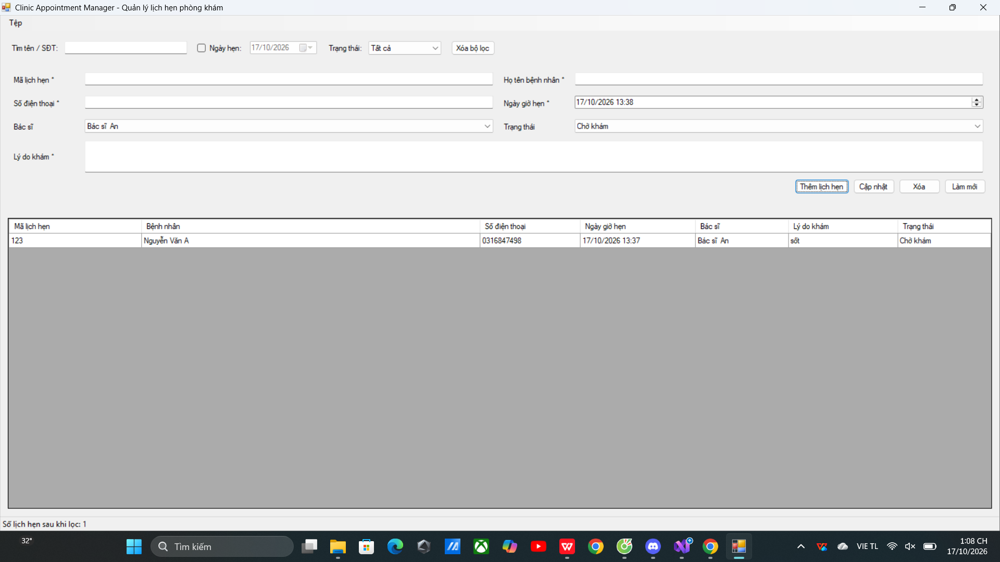

##### 4.9.2 Kiểm tra xác thực dữ liệu đầu vào (Validation Error)
Hệ thống hiển thị biểu tượng chấm than đỏ qua `ErrorProvider` và cảnh báo hộp thoại khi thông tin không hợp lệ hoặc thiếu thông tin bắt buộc.
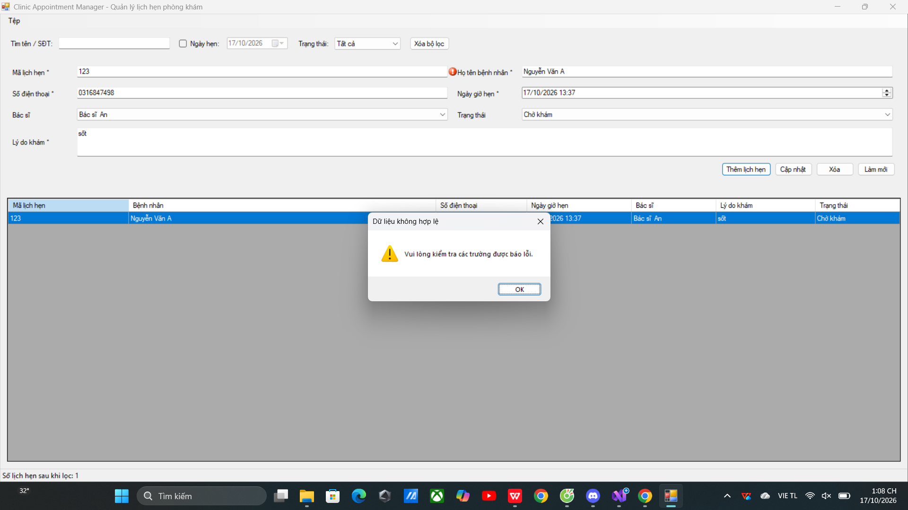

##### 4.9.3 Hộp thoại xác nhận cập nhật thông tin lịch hẹn
Hỏi xác nhận trước khi lưu lại thông tin sửa đổi nhằm bảo toàn tính chính xác của dữ liệu.
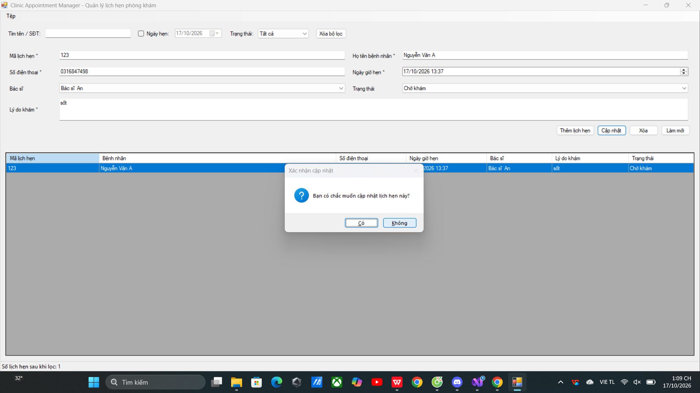

##### 4.9.4 Hộp thoại xác nhận xóa lịch hẹn
Cảnh báo với tên bệnh nhân cụ thể nhằm tránh việc xóa nhầm hồ sơ hẹn khám.
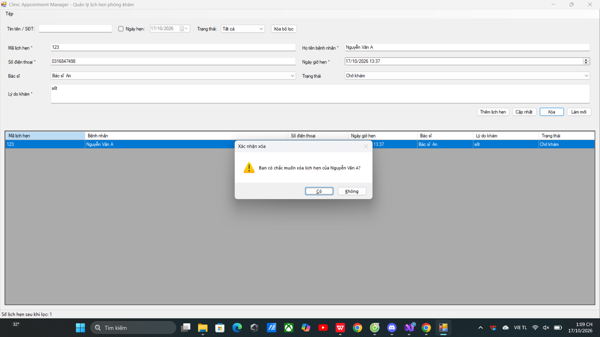

##### 4.9.5 Danh sách lựa chọn bác sĩ và nạp dữ liệu lên DataGridView
Lựa chọn danh mục bác sĩ từ danh sách sổ xuống `ComboBox` và đồng bộ hiển thị chi tiết lịch hẹn.
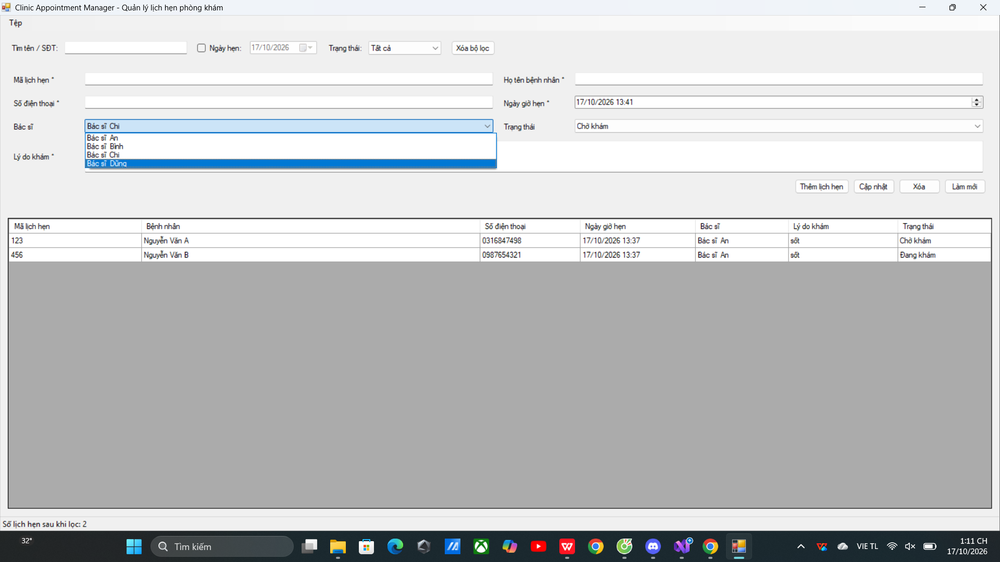

---

### PHẦN 2. BÀI 4.10 – QUẢN LÝ MƯỢN TRẢ THIẾT BỊ PHÒNG THỰC HÀNH (LAB EQUIPMENT CHECKOUT)
#### 4. Hình ảnh minh chứng kết quả thực hành

##### 4.10.1 Giao diện chính Quản lý mượn trả thiết bị
Khu vực biểu mẫu nhập phiếu mượn, bộ điều khiển số lượng `NumericUpDown`, lựa chọn ngày tháng và bảng danh sách phiếu mượn.
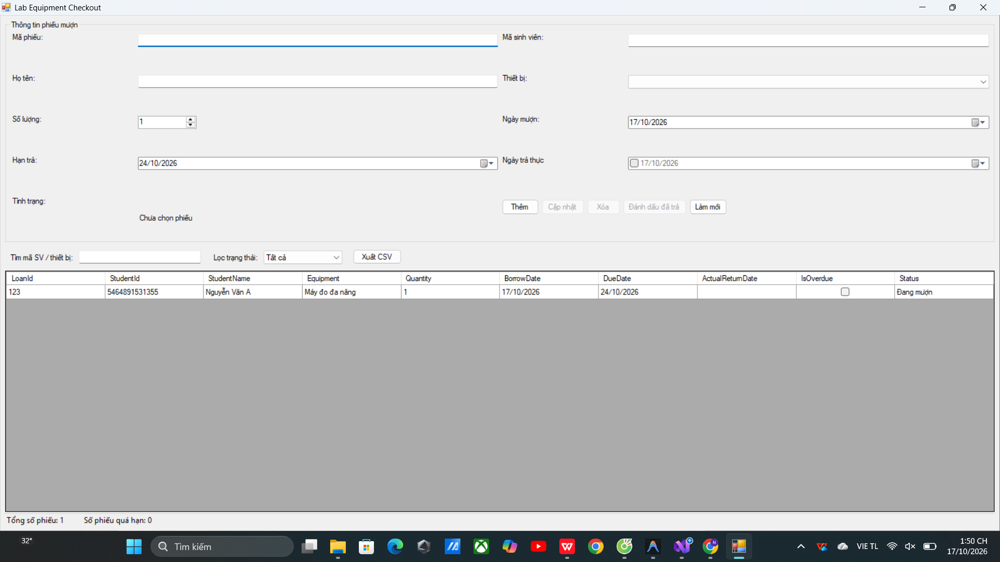

##### 4.10.2 Hộp thoại xác nhận xóa phiếu mượn thiết bị
Cảnh báo xác nhận người dùng khi thực hiện hủy bỏ một phiếu mượn khỏi hệ thống.
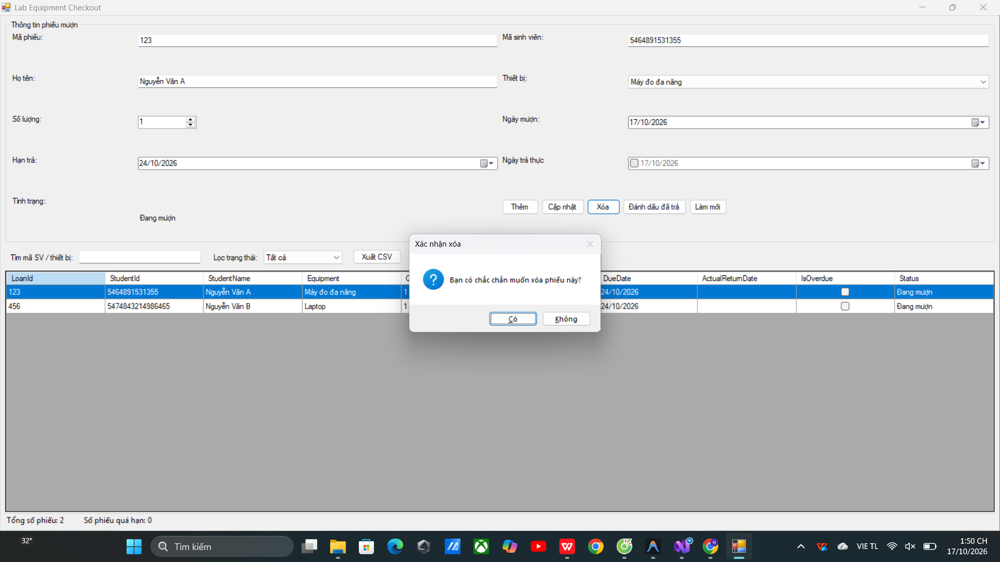

##### 4.10.3 Đánh dấu hoàn tất trả thiết bị thành công
Trạng thái phiếu được cập nhật thành **Đã trả**, trường `Ngày trả thực` tự động được tích chọn và ghi nhận ngày hiện tại.
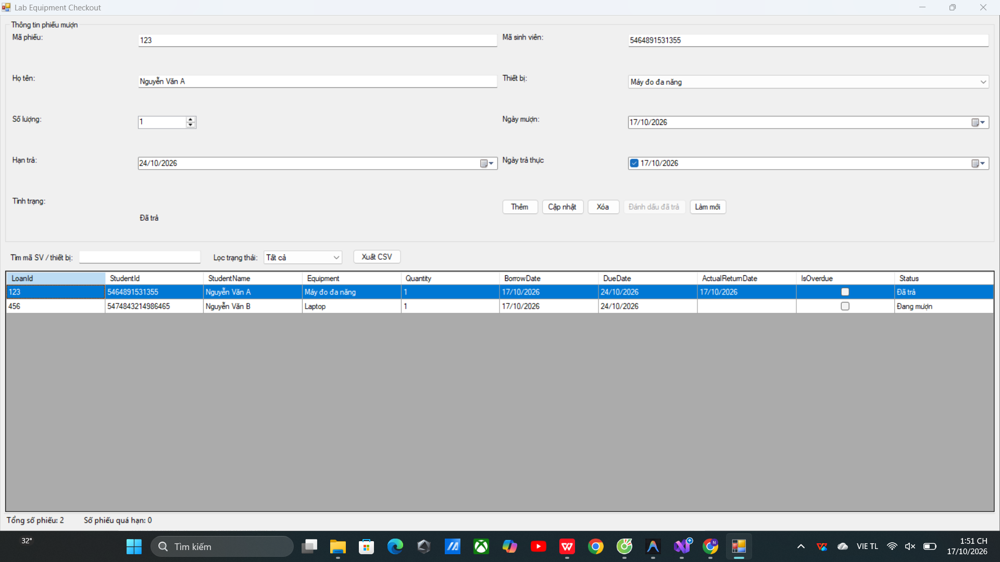

##### 4.10.4 Xuất danh sách phiếu mượn thiết bị ra file CSV
Tích hợp `SaveFileDialog` cho phép người dùng đặt tên và chọn vị trí lưu tệp `phieu-muon-thiet-bi.csv`.
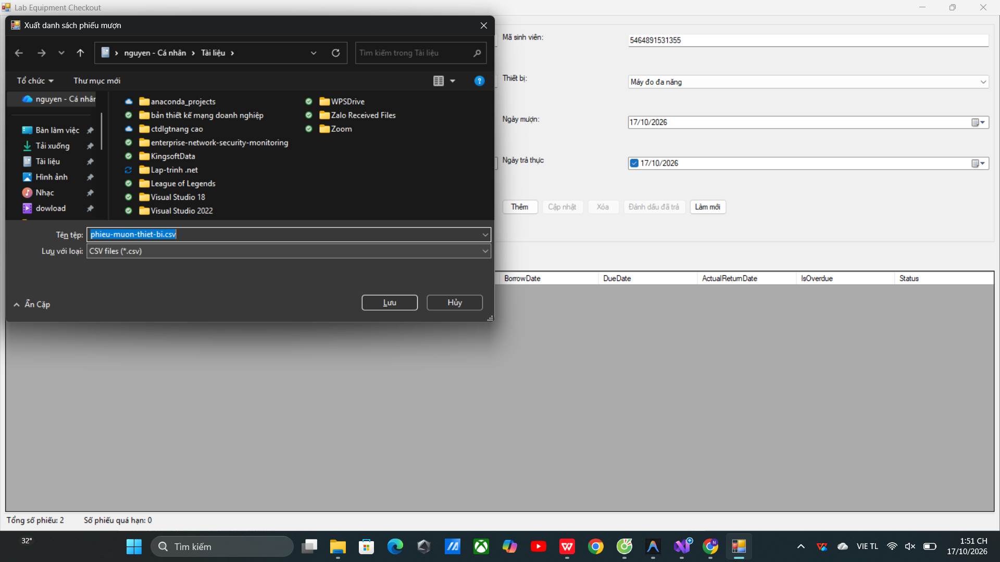

---

### PHẦN 3. BÀI 4.11 – HỆ THỐNG THEO DÕI TIẾP NHẬN SỬA CHỮA THIẾT BỊ (REPAIR SERVICE TRACKER)
#### 4. Hình ảnh minh chứng kết quả thực hành

##### 4.11.1 Giao diện chính Hệ thống tiếp nhận dịch vụ sửa chữa
Hiển thị danh sách dữ liệu mẫu đầy đủ các loại thiết bị, trạng thái sửa chữa, chi phí và thanh trạng thái tổng hợp tổng chi phí các đơn chưa hoàn tất.
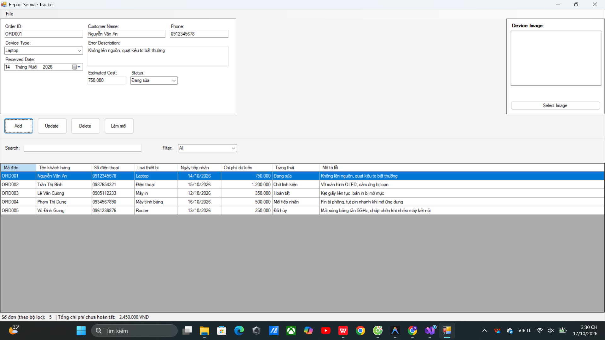

##### 4.11.2 Hộp thoại xác nhận thêm mới đơn tiếp nhận
Xác nhận người dùng trước khi lưu đơn dịch vụ vào hệ thống.
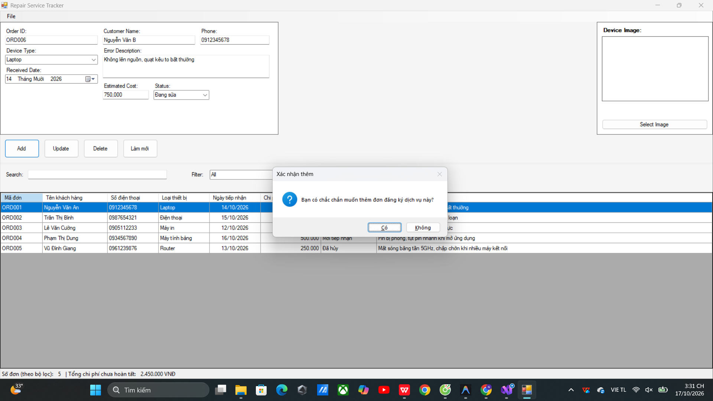

##### 4.11.3 Thông báo thêm đơn thành công
Hiển thị hộp thoại thông báo `MessageBoxIcon.Information` xác nhận mã đơn mới đã được nạp vào danh sách.
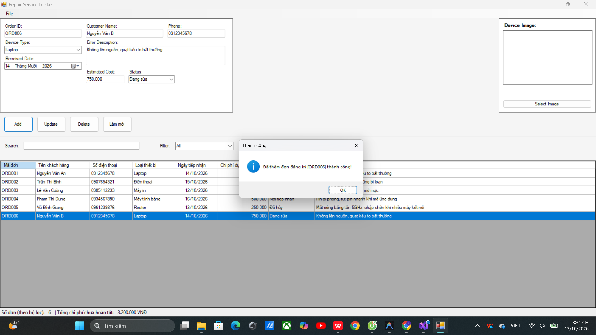

##### 4.11.4 Hộp thoại xác nhận cập nhật thông tin đơn sửa chữa
Cho phép chỉnh sửa thông tin đơn và yêu cầu xác nhận thao tác cập nhật.
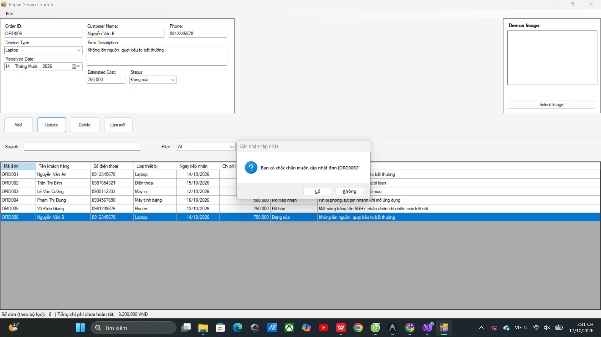

##### 4.11.5 Hộp thoại xác nhận xóa đơn tiếp nhận
Cảnh báo với mã đơn và tên khách hàng cụ thể khi thực hiện xóa bản ghi.
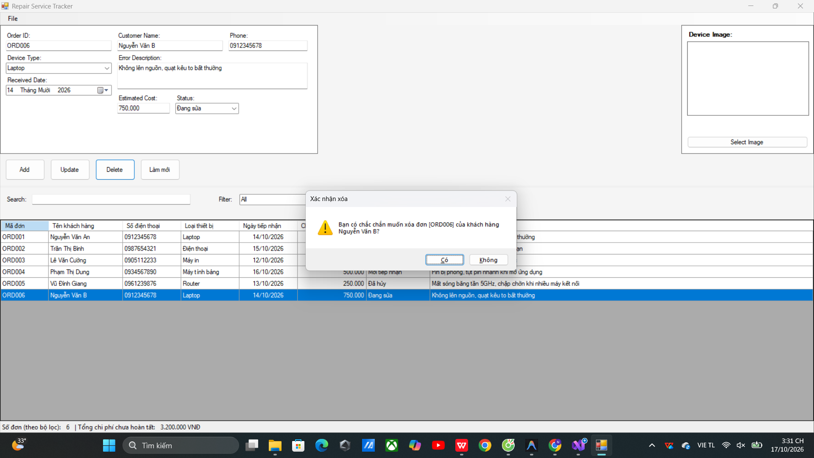
