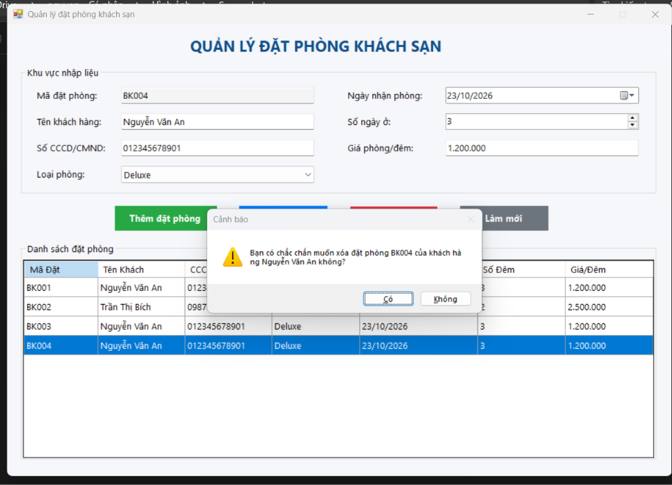
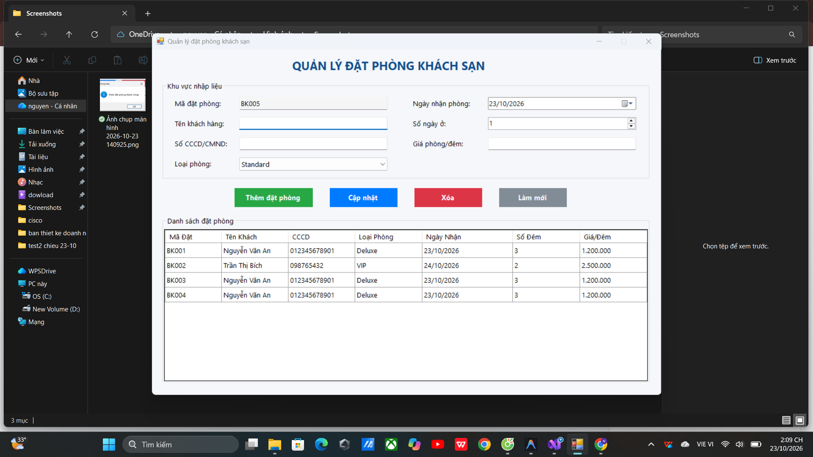
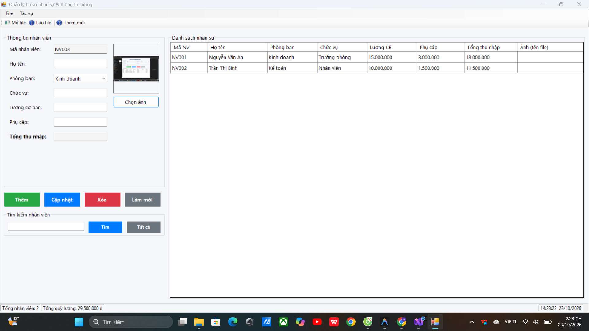
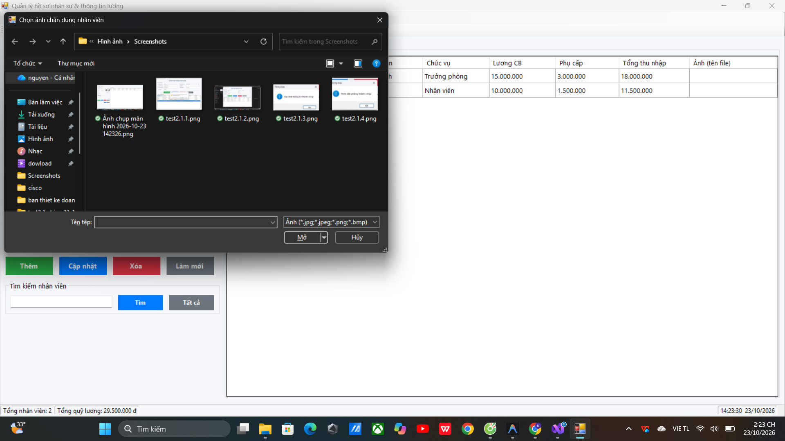
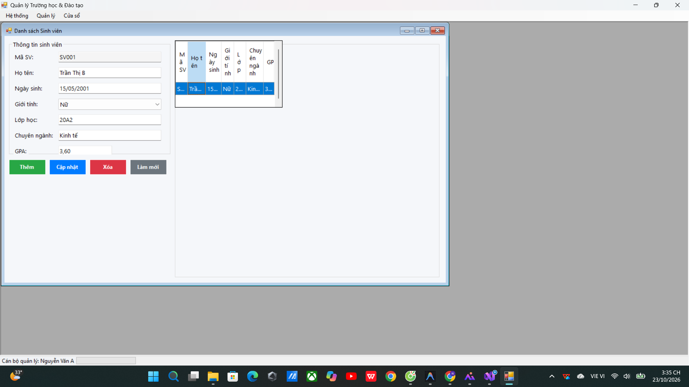
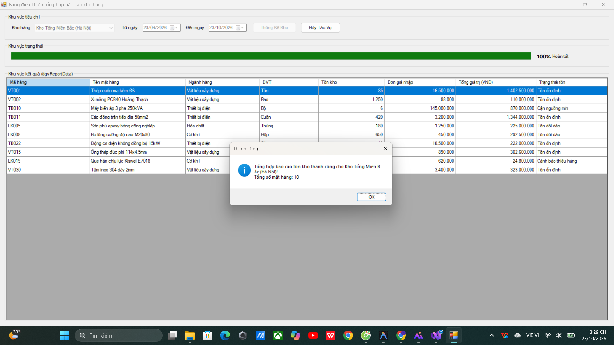
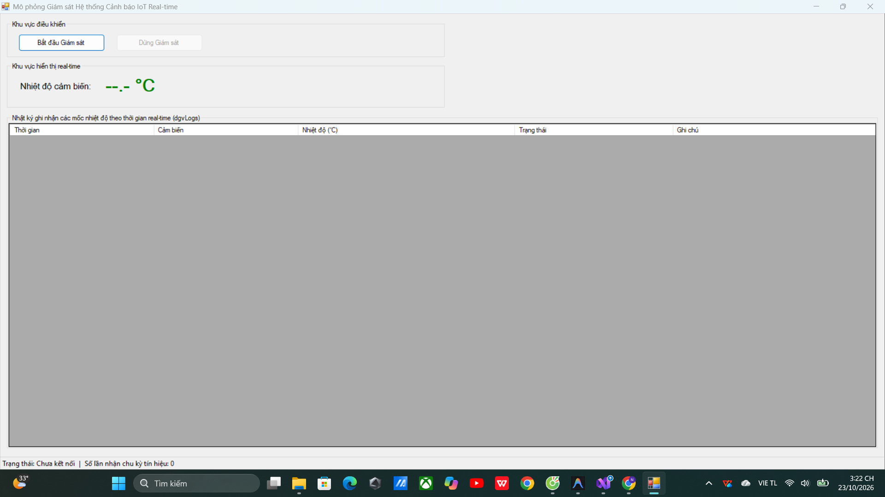

# BÁO CÁO BÀI TẬP THỰC HÀNH LẬP TRÌNH C# WINFORMS

## I. THÔNG TIN SINH VIÊN
* **Họ và tên:** Nguyễn Anh Xuân
* **Mã số sinh viên:** 24810320189
* **Lớp học phần:** D19QTANM1 - Lập trình .NET

---

## II. DANH SÁCH BÀI TẬP HOÀN THÀNH & TỰ ĐÁNH GIÁ

| Bài tập | Tiêu đề bài tập | Trạng thái | Mức độ hoàn thành (%) |
| :---: | :--- | :---: | :---: |
| **Bài 1** | Quản lý Đặt phòng Khách sạn (Data Binding 2 chiều & Validation) | Hoàn thành | 100% |
| **Bài 2** | Quản lý Hồ sơ Nhân sự & Lương (System Dialogs & File I/O) | Hoàn thành | 100% |
| **Bài 3** | Hệ thống MDI Quản lý Trường học & Đào tạo | Hoàn thành | 100% |
| **Bài 4** | Bảng điều khiển Báo cáo Kho hàng (Async/Await & Không khóa UI) | Hoàn thành | 100% |
| **Bài 5** | Mô phỏng Giám sát Cảnh báo IoT Real-time (Cross-Thread Safety) | Hoàn thành | 100% |

---

## III. MINH HỌA GIAO DIỆN & KỸ THUẬT NỔI BẬT

### 1. Bài 1: Quản lý Đặt phòng Khách sạn
* **Kỹ thuật áp dụng:** Cấu hình DataGridView bằng code (`AutoGenerateColumns = false`), Data Binding 2 chiều với `BindingSource` và `BindingList<T>`, Validation với `ErrorProvider` (kiểm tra CCCD 12 số, ngày nhận, số ngày ở >= 1, tính thành tiền tự động).
* **Hình ảnh minh họa Giao diện:**

*Mô tả: Giao diện chính hiển thị DataGridView và đồng bộ dữ liệu 2 chiều lên các ô nhập liệu.*

*Mô tả: Kiểm tra hợp lệ dữ liệu nhập vào bằng ErrorProvider khi nhấn Thêm đặt phòng.*

---

### 2. Bài 2: Quản lý Hồ sơ Nhân sự & Lương
* **Kỹ thuật áp dụng:** `OpenFileDialog` (chọn ảnh chân dung hiển thị lên PictureBox và nạp dữ liệu từ file CSV), `SaveFileDialog` (xuất file CSV chuẩn UTF-8), MenuStrip, ToolStrip và cập nhật `StatusStrip` (tổng nhân viên, tổng quỹ lương, đồng hồ thời gian thực).
* **Hình ảnh minh họa Giao diện:**

*Mô tả: Chọn ảnh chân dung từ đĩa cứng hiển thị lên PictureBox và quản lý hồ sơ nhân sự.*

*Mô tả: Đọc và ghi dữ liệu danh sách nhân sự từ file CSV qua OpenFileDialog / SaveFileDialog.*

---

### 3. Bài 3: Hệ thống MDI Quản lý Trường học & Đào tạo
* **Kỹ thuật áp dụng:** Kiến trúc Form cha MDI (`IsMdiContainer = true`), quản lý chống mở trùng Form con (duyệt `MdiChildren` gọi `Activate()`), điều hướng sắp xếp cửa sổ (Cascade, Tile Horizontal, Tile Vertical, Close All).
* **Hình ảnh minh họa Giao diện:**

*Mô tả: Khung Form cha MDI điều khiển mở các Form con (Sinh viên, Môn học) không bị mở trùng lặp.*

---

### 4. Bài 4: Bảng điều khiển Báo cáo Kho hàng (Async/Await & Không khóa UI)
* **Kỹ thuật áp dụng:** Lập trình bất đồng bộ với `async`/`await` và `Task.Run(...)` giả lập xử lý quét dữ liệu kho nặng 4-5 giây mà không làm treo UI, hủy tiến trình an toàn bằng `CancellationTokenSource`, cập nhật `ProgressBar` và `Label %` qua `Progress<T>`.
* **Hình ảnh minh họa Giao diện:**

*Mô tả: Tiến trình ngầm chạy tải dữ liệu nặng dưới Background Thread, giao diện vẫn di chuyển và thao tác bình thường không bị Not Responding.*

---

### 5. Bài 5: Mô phỏng Giám sát Cảnh báo IoT Real-time (Cross-Thread Safety)
* **Kỹ thuật áp dụng:** Tiến trình ngầm lặp định kỳ 2 giây/lần bằng `Task.Run`, tuân thủ nghiêm ngặt quy tắc Thread Safety trong WinForms qua `this.InvokeRequired` / `this.Invoke()`, đổi màu cảnh báo nhiệt độ (> 37°C đỏ, <= 37°C xanh), ghi nhật ký `DataGridView` thời gian thực.
* **Hình ảnh minh họa Giao diện:**

*Mô tả: Hệ thống tự động nhận tín hiệu nhiệt độ định kỳ 2 giây/lần và đổi màu cảnh báo theo thời gian thực an toàn đa luồng.*
