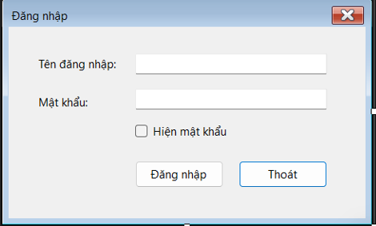
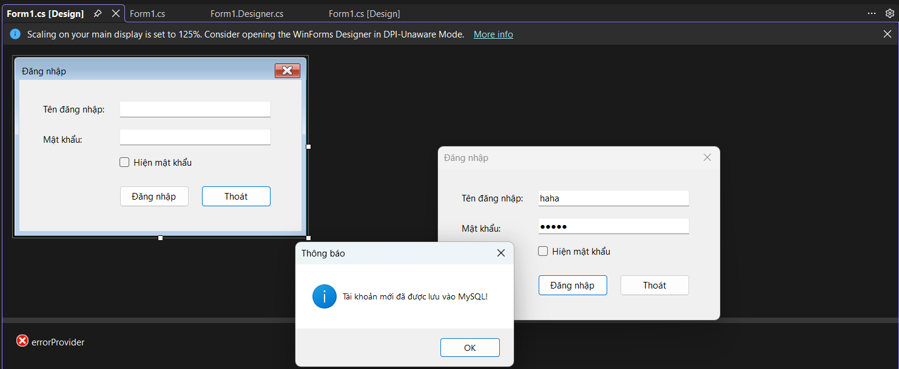
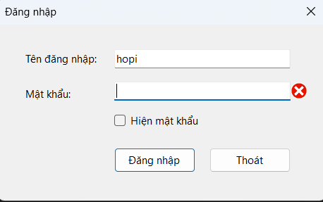
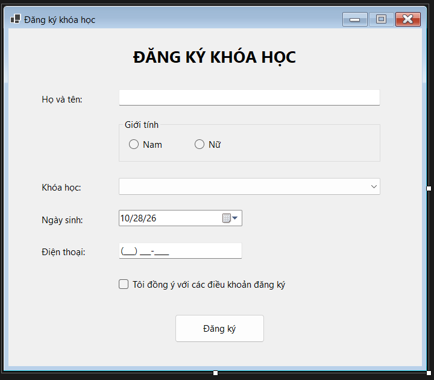
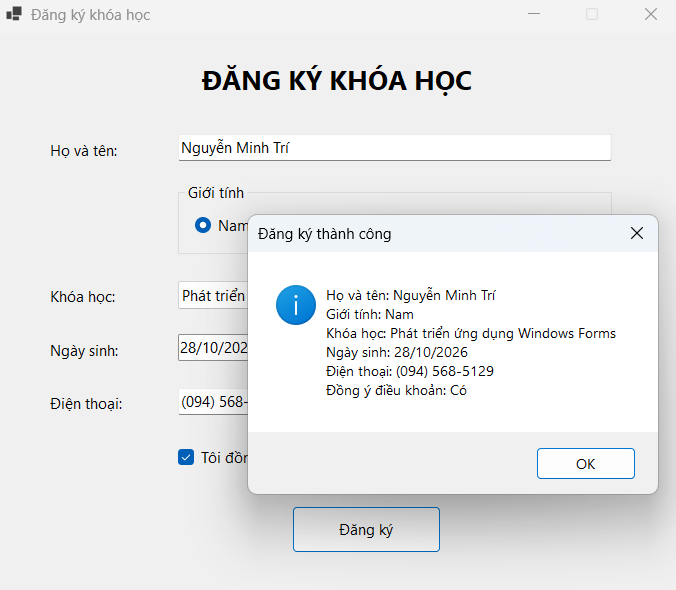
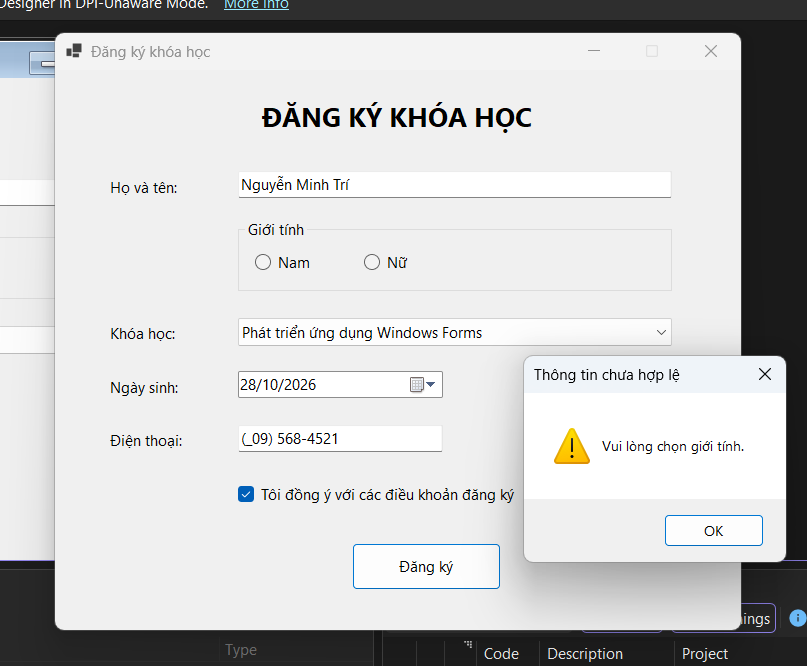

## THÔNG TIN SINH VIÊN
- **Họ và tên:** Nguyễn Anh Xuân
- **Mã số sinh viên:** 24810320189
- **Lớp:** D19QTANM1
- **Học phần:** Lập trình .NET / Lập trình Windows Forms
- **Tên bài tập:** Bài tập thực hành ngày 28/10 – Bài 5.1, Bài 5.2

---

### PHẦN 1. BÀI 5.1 – FORM ĐĂNG NHẬP & TẠO TÀI KHOẢN NGƯỜI DÙNG (LOGIN & USER ACCOUNT)
#### Hình ảnh minh chứng kết quả thực hành

##### 5.1.1 Giao diện chính Form Đăng nhập
Form nhập liệu tài khoản người dùng với chức năng tùy chọn ẩn/hiện mật khẩu qua CheckBox.

##### 5.1.2 Đăng nhập thành công với tài khoản quản trị
Hệ thống xác thực tài khoản hợp lệ từ CSDL MySQL `login_db` và thông báo đăng nhập thành công.

##### 5.1.3 Tự động tạo mới tài khoản và đăng nhập vào hệ thống
Tự động ghi nhận thông tin người dùng mới vào bảng `Users` khi tài khoản chưa từng tồn tại trên hệ thống.
.png)

##### 5.1.4 Kiểm tra xác thực dữ liệu đầu vào (Validation Error)
Hiển thị thông báo cảnh báo khi người dùng để trống tên đăng nhập hoặc mật khẩu.

---

### PHẦN 2. BÀI 5.2 – HỆ THỐNG ĐĂNG KÝ KHÓA HỌC TRỰC TUYẾN (COURSE REGISTRATION)
#### Hình ảnh minh chứng kết quả thực hành

##### 5.2.1 Giao diện chính Form Đăng ký khóa học
Khu vực biểu mẫu nhập liệu thông tin học viên và bảng DataGridView hiển thị danh sách khóa học đã đăng ký.

##### 5.2.2 Đăng ký khóa học thành công và nạp dữ liệu lên DataGridView
Lưu thông tin đăng ký vào CSDL MySQL `CourseRegistrationDb` và đồng bộ hiển thị lên bảng dữ liệu.

##### 5.2.3 Kiểm tra xác thực thông tin họ tên học viên
Cảnh báo hộp thoại khi người dùng không nhập họ tên trước khi nhấn Đăng ký.

##### 5.2.4 Kiểm tra xác thực số điện thoại và lựa chọn khóa học
Kiểm tra tính hợp lệ của số điện thoại và đảm bảo người dùng đã chọn khóa học hợp lệ.
.png)
