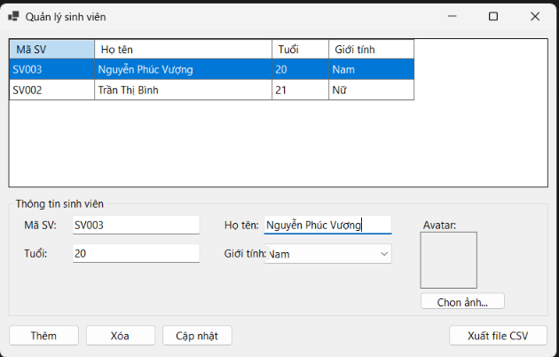
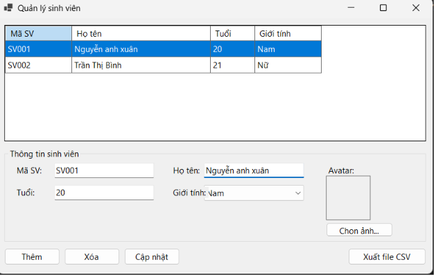
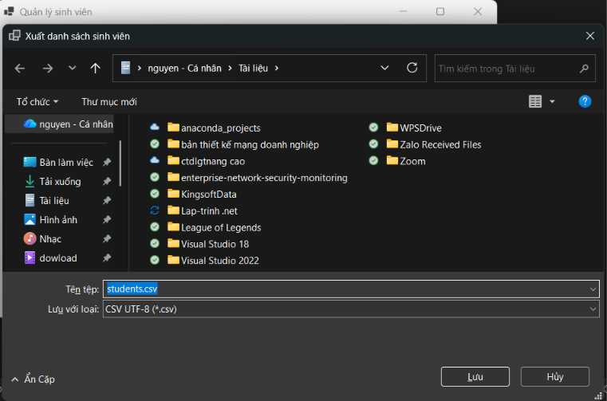
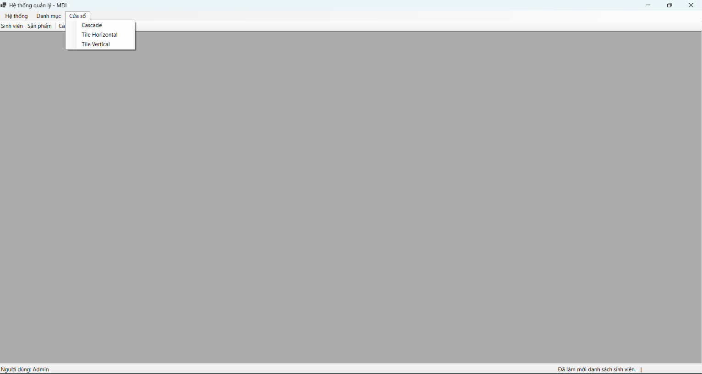
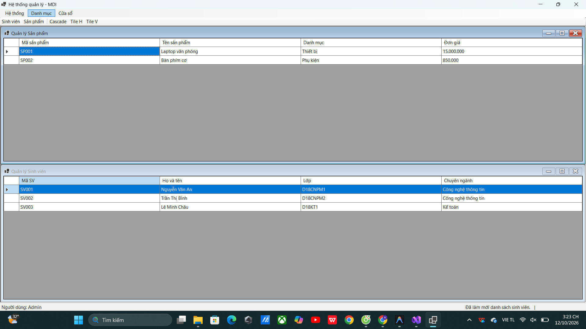
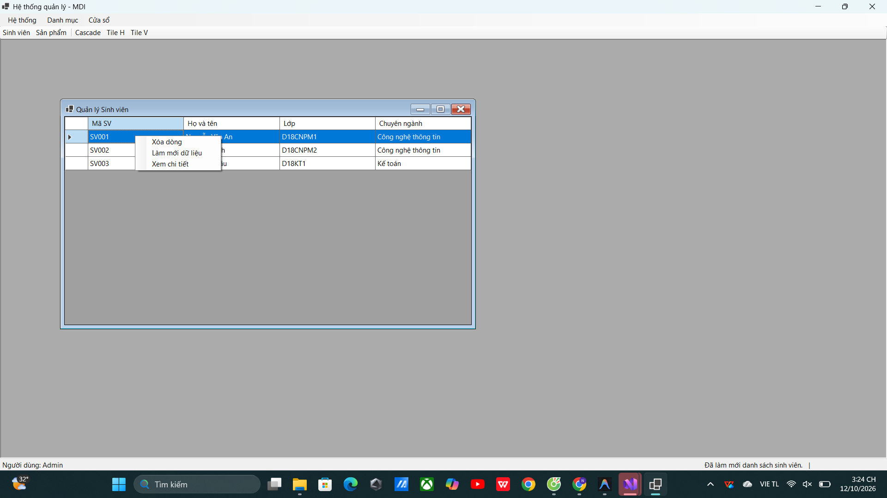

# BÁO CÁO BÀI TẬP / ĐỒ ÁN

## THÔNG TIN SINH VIÊN
- **Họ và tên:** Nguyễn Anh Xuân
- **Mã số sinh viên:** 24810320189
- **Lớp:** D19QTANM1
- **Tên môn học:** Lập trình C# / Windows Forms (.NET)
- **Tên bài tập:** Báo cáo thực hành ngày 12/10 (Bài 4.6, Bài 4.7, Bài 4.8)

---

## MỤC LỤC
1. [Bài 4.6: Quản lý sinh viên với DataGridView & Data Binding](#bài-46-quản-lý-sinh-viên-với-datagridview--data-binding)
2. [Bài 4.7: Ứng dụng quản lý giao diện nhiều tài liệu (MDI)](#bài-47-ứng-dụng-quản-lý-giao-diện-nhiều-tài-liệu-mdi)
3. [Bài 4.8: Lập trình bất đồng bộ trong Windows Forms (Async / Await & Progress)](#bài-48-lập-trình-bất-đồng-bộ-trong-windows-forms-async--await--progress)

---

## BÀI 4.6: QUẢN LÝ SINH VIÊN VỚI DATAGRIDVIEW & DATA BINDING

### 1. Mô tả bài toán
Xây dựng ứng dụng Windows Forms cho phép quản lý hồ sơ sinh viên với các tính năng:
- Hiển thị danh sách sinh viên qua **DataGridView** kết hợp cơ chế **Data Binding** hai chiều (`BindingList<Student>` và `BindingSource`).
- Đồng bộ thông tin sinh viên được chọn lên các ô nhập liệu (**TextBox**, **ComboBox**) và hiển thị ảnh đại diện (**PictureBox**).
- Thêm, sửa, xóa thông tin sinh viên có kiểm tra tính hợp lệ dữ liệu (validation không để trống mã SV/họ tên, tuổi từ 1 - 150, kiểm tra trùng mã SV).
- Hộp thoại xác nhận trước khi xóa dữ liệu.
- Xuất danh sách sinh viên ra tệp tin định dạng **CSV** (UTF-8).

### 2. Kết quả thực hành

#### 2.1. Giao diện chính

#### 2.2. Nhập và cập nhật thông tin sinh viên

#### 2.3. Hộp thoại xuất danh sách ra file CSV

---

## BÀI 4.7: ỨNG DỤNG QUẢN LÝ GIAO DIỆN NHIỀU TÀI LIỆU (MDI)

### 1. Mô tả bài toán
Xây dựng ứng dụng **MDI (Multiple Document Interface)** chuyên nghiệp quản lý danh mục:
- Form cha (`FormMain`) đóng vai trò là `MdiContainer`, chứa hệ thống điều hướng gồm **MenuStrip**, **ToolStrip**, **StatusStrip**, và **ContextMenuStrip**.
- Hai form con: **Quản lý Sinh viên** (`FormStudent`) và **Quản lý Sản phẩm** (`FormProduct`).
- Ngăn ngừa mở trùng lặp nhiều thể hiện của cùng một form con (Single Instance per Form Type) bằng cách kích hoạt (`Activate()`) form đang mở.
- Điều khiển cách hiển thị cửa sổ con thông qua các bố cục: **Cascade** (xếp chồng), **Tile Horizontal** (xếp ngang), **Tile Vertical** (xếp dọc).
- Truyền sự kiện từ form con về form cha thông qua custom event `StatusChanged (StatusMessageEventArgs)` để cập nhật trạng thái lên `StatusStrip`.
- Hiển thị thông tin người dùng và đồng hồ thời gian thực (`System.Windows.Forms.Timer`) trên thanh trạng thái.

### 2. Kết quả thực hành

#### 2.1. Giao diện Form chính MDI

#### 2.2. Menu Danh mục (Chọn mở Quản lý Sinh viên / Sản phẩm)

#### 2.3. Menu Cửa sổ (Điều khiển bố cục Cascade / Tile Horizontal / Tile Vertical)

#### 2.4. Mở Form con Quản lý Sinh viên

#### 2.5. Mở đồng thời cả 2 Form con (Quản lý Sinh viên & Quản lý Sản phẩm)

#### 2.6. Sắp xếp cửa sổ theo chiều ngang (Tile Horizontal)

#### 2.7. Sắp xếp cửa sổ theo chiều dọc (Tile Vertical)

#### 2.8. Menu ngữ cảnh (ContextMenuStrip) trên DataGridView

---

## BÀI 4.8: LẬP TRÌNH BẤT ĐỒNG BỘ TRONG WINDOWS FORMS (ASYNC / AWAIT & PROGRESS)

### 1. Mô tả bài toán
Xây dựng ứng dụng mô phỏng xử lý nạp dữ liệu nặng trong luồng nền (background thread) để đảm bảo giao diện người dùng không bị treo đơ:
- Sử dụng **async / await** kết hợp `Task.Run()` để nạp 100 bản ghi sinh viên bất đồng bộ.
- Áp dụng mẫu thiết kế `IProgress<int>` / `Progress<T>` để báo cáo tiến trình (0% - 100%) từ luồng nền về UI thread một cách an toàn.
- Cập nhật tiến trình đồng thời trên `ProgressBar` của form con và `ToolStripProgressBar` trên `StatusStrip` của form cha MDI thông qua delegate callback `Action<int>`.
- Khóa nút "Nạp danh sách" trong thời gian thực thi để chống thao tác bấm lặp lại (re-entrancy).
- Hiển thị hộp thoại thông báo nạp dữ liệu hoàn tất khi đạt 100%.

### 2. Kết quả thực hành

#### 2.1. Giao diện trước khi nạp dữ liệu (Tiến trình 0%)

#### 2.2. Hoàn tất nạp dữ liệu bất đồng bộ (Tiến trình 100% & Bảng dữ liệu)

---
